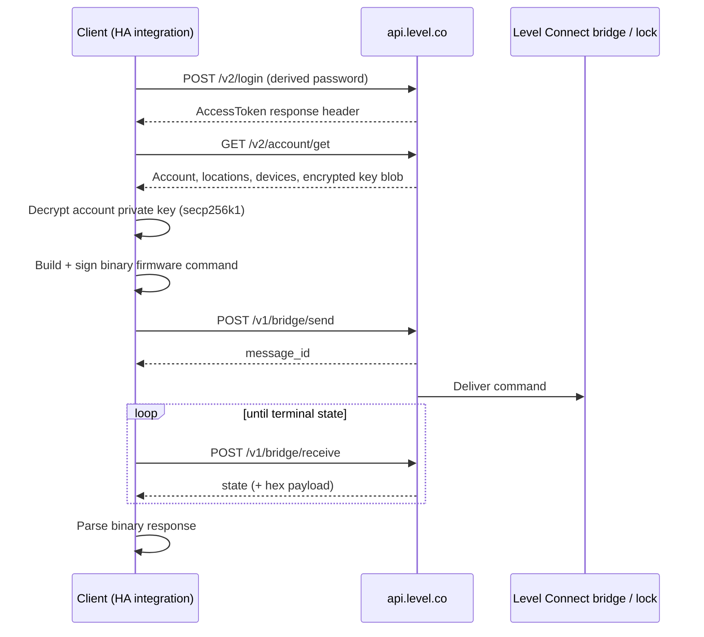

# Level Cloud API: Reference Wiki

Reverse-engineered documentation of the **undocumented** Level cloud API used by the Level Home Android app. It is the source of truth for implementing `custom_components/level_lock_cloud/api.py`, and is written for both people and AI assistants.

> ⚠️ Unofficial. Nothing here is endorsed by Level Home Inc. It describes one app build (Level Home **2.5.0.56**, package `co.level.app`) and may not match other versions.

## How the API works in one picture

Two separate credentials are involved:

- **`AccessToken`** authenticates HTTPS calls to `api.level.co`.
- **Account private key**, decrypted from the account blob with the user's password, signs each lock command. The cloud only relays commands; the lock checks the signature.

## Rules for this folder

- Only Markdown files (`*.md`) and images (`images/`) live here.
- **Never commit real secrets or identifiers**: tokens, passwords, emails, phone numbers, UUIDs, serial numbers, keys, raw account responses. Use placeholders such as `<ACCESS_TOKEN>`, `<LOCK_UUID>`, `owner@example.invalid`, or all-zero UUIDs.
- Tag every claim with its evidence level and source.
- One endpoint per file in [`endpoints/`](endpoints/), based on [`_template.md`](endpoints/_template.md).
- Record new discoveries in [findings.md](findings.md) first, then move them into the right page.

### Evidence levels

| Tag | Meaning |
|---|---|
| ✅ **Verified** | Called against the live API, or the physical result was confirmed by the owner |
| 🔍 **From APK** | Found in the decompiled app; not tested live |
| ⚙️ **Client** | Behaviour chosen by our proof-of-concept client; may be stricter than the app or server |
| ❓ **Unknown** | Not established; needs investigation |

## Pages

| Page | Contents |
|---|---|
| [overview.md](overview.md) | Host, headers, versions, the three layers of the API |
| [authentication.md](authentication.md) | Login, password derivation, `AccessToken`, 2FA, logout |
| [account-key.md](account-key.md) | Decrypting the account signing key from the account blob |
| [command-protocol.md](command-protocol.md) | Binary signed command format, opcodes, payloads, response parsing |
| [models.md](models.md) | JSON models (`Account`, `LocationItem`, `DeviceItem`, …) and enum codes |
| [errors.md](errors.md) | Error layers, transport states, retry rules |
| [findings.md](findings.md) | Open questions, corrections, and a dated discovery log |
| [endpoints/](endpoints/) | One page per endpoint |

## Endpoints

| Method | Path | Purpose | Page | Status |
|---|---|---|---|---|
| POST | `/v2/login` | Sign in, get `AccessToken` | [post-v2-login.md](endpoints/post-v2-login.md) | ✅ |
| GET | `/v2/account/get` | Account, locations, locks, encrypted key blob | [get-v2-account-get.md](endpoints/get-v2-account-get.md) | ✅ |
| POST | `/v1/bridge/send` | Submit a signed command to a lock via its bridge | [post-v1-bridge-send.md](endpoints/post-v1-bridge-send.md) | ✅ |
| POST | `/v1/bridge/receive` | Poll for a command's result | [post-v1-bridge-receive.md](endpoints/post-v1-bridge-receive.md) | ✅ |
| POST | `/v2/logout` | End the session | [post-v2-logout.md](endpoints/post-v2-logout.md) | 🔍 |
| POST | `/v1/2fa/otp/send`, `/v1/2fa/confirm`, `/v1/2fa/contacts` | Two-factor login | [2fa.md](endpoints/2fa.md) | 🔍 |
| — | Other bridge, pass, account and OAuth routes | Not used by the integration | [other-routes.md](endpoints/other-routes.md) | 🔍 |

## Status of what the integration needs

| Capability | Status |
|---|---|
| Login without 2FA | ✅ |
| List locks | ✅ |
| Decrypt signing key | ✅ |
| Lock / unlock | ✅ (owner confirmed physically, Front Door) |
| Read last operation from the lock (history) | ✅ |
| Login with 2FA enabled | 🔍 full flow traced from APK, not tested live |
| Battery level | 🔍 `AdvertisingDataV2.battery_level` (coarse: red / yellow / green) |
| Door open / closed | 🔍 `door_sense_state` codes known |
| Token lifetime / refresh | ❓ |
| Push / realtime state | ❓ |
| Live "current bolt position" query | ❓ (`SystemStatusGet` / `StateBroadcastGet` not traced) |
