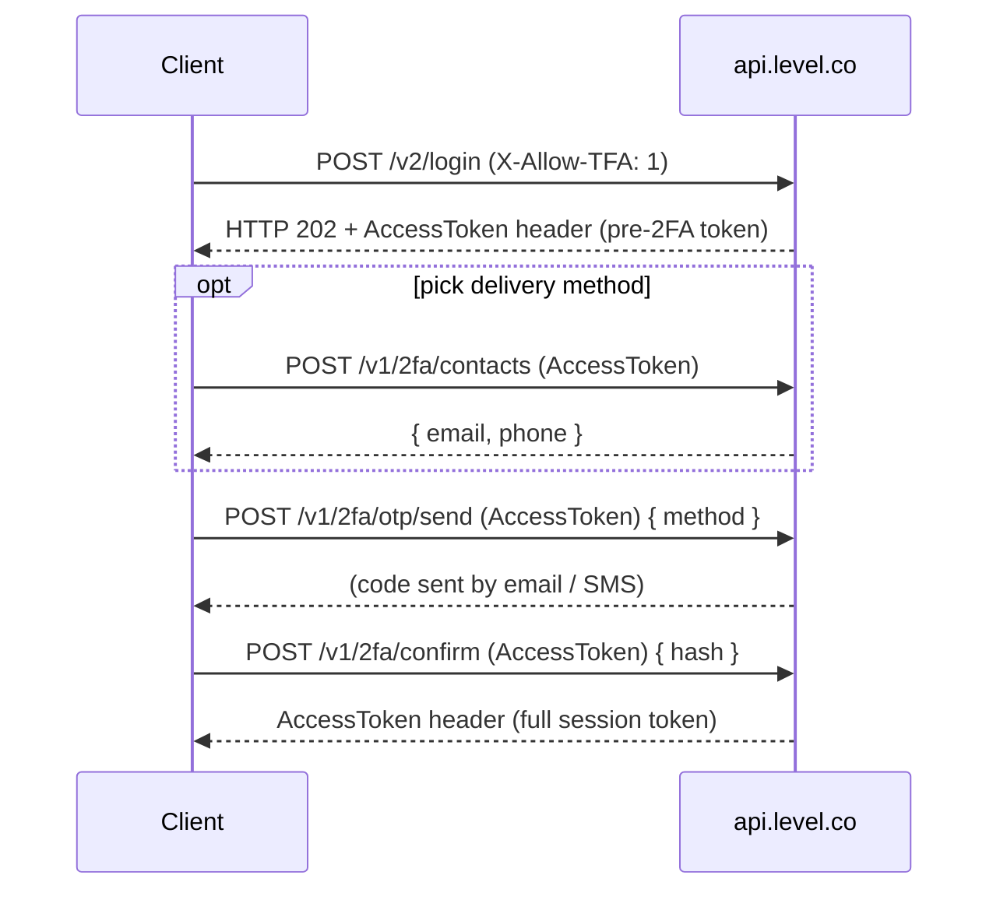

# Two-factor authentication (2FA)

**Evidence:** 🔍 From APK (decompiled 2.5.0.56). Not tested live (owner account has 2FA off).
**Source:** routes `_.pe`; repository `_.kif` (`g` login, `a` confirm, `f` contacts, `j` otp/send); login manager `_.vk0.a`; confirm hashing `_.ybf.r`; models `Model2fa*`
**Used by integration:** planned, config-flow 2FA step

## Login flow with 2FA



1. **Login** as normal with header `X-Allow-TFA: 1` (the app always sends `1`).
2. If 2FA is required, the server answers **HTTP `202 Accepted`**. The app treats a 202 as 2FA required and adds `tfaEnabled` to `status` itself (`_.kif.g`). The server may also put `tfaEnabled` in `status`; check both.
3. The 202 response **still carries an `AccessToken` header**. The app throws `Access token expected` if it is missing. This token is used for the 2FA calls.
4. Request a code with `/v1/2fa/otp/send`.
5. Hash the code the user types and send it to `/v1/2fa/confirm`.
6. Read the session token from confirm's `AccessToken` response header. If the header is missing or equal to the old token, keep using the old one (`_.kif.a`).

Whether the pre-2FA token can call `/v2/account/get` before confirmation is ❓. Assume not.

## `POST /v1/2fa/otp/send`

Ask the server to send a one-time code.

| Header | Value |
|---|---|
| `AccessToken` | Token from the 202 login response |

```json
{ "method": "email" }
```

| Field | Type | Required | Values |
|---|---|---|---|
| `method` | string | yes | `email`, `phone` (`unknown` also exists in the enum) |

Response: empty body (no-data model). One app screen defaults to `phone`.

## `POST /v1/2fa/confirm`

Submit the code.

| Header | Value |
|---|---|
| `AccessToken` | Token from the 202 login response |

```json
{ "hash": "<12 lowercase hex chars>" }
```

| Field | Type | Required | Description |
|---|---|---|---|
| `hash` | string | yes | First 12 characters of the lowercase hex SHA-256 of the code |

The raw code is **never sent**:

```python
import hashlib

def otp_hash(code: str) -> str:
    return hashlib.sha256(code.encode("utf-8")).hexdigest()[:12]
```

Response: empty body; new session token in the `AccessToken` response **header**.

## `POST /v1/2fa/contacts`

Returns where codes can be sent, so the user can choose.

| Header | Value |
|---|---|
| `AccessToken` | Session token (optional in the generated client) |

```json
{
  "hashed_password": "<base64 login value>",
  "hashed_recovery_key": null
}
```

| Field | Type | Required | Description |
|---|---|---|---|
| `hashed_password` | Base64 string | no | Same derived value as the `/v2/login` `password` ([derivation](../authentication.md#login-password-derivation-)) |
| `hashed_recovery_key` | Base64 string | no | Recovery-key alternative (same derivation helper) |

Response:

```json
{ "email": "<string>", "phone": "<string>" }
```

Both optional. Probably masked ❓.

JSON names `hashed_password` / `hashed_recovery_key` come from DEX strings; the serializer for this model was not emitted by JADX, so the mapping is inferred. ❓

## `POST /v1/2fa/enable` and `/v1/2fa/disable`

Account settings, not needed by the integration. No `AccessToken` header is added by the generated client for these two (it may come from a shared auth plugin ❓).

| Route | Body |
|---|---|
| `/v1/2fa/enable` | `{ "method": "<email/phone>", "contact": "<address>", "hashed_password": "<base64>" }` |
| `/v1/2fa/disable` | `{ "method": "<email/phone>", "hashed_password": "<base64>" }` |

## Errors

Error bodies use the app's `StandardError` model: `{ "code": int, "message": string, "data": { "seconds": long } }`. `data.seconds` is likely a rate-limit wait (the login screen has a `RateLimitException`). ❓ Specific codes for a wrong or expired OTP are unknown.

## Still unknown

- Whether the server sends a code automatically on the 202, or only after `otp/send`.
- Wrong / expired code behaviour and retry limits.
- Lifetime of the post-2FA token, and whether later logins need 2FA again (no "trusted device" field was found in the login or confirm models).

## Planned integration behaviour

1. Config flow step `user`: email + password → `/v2/login`.
2. If HTTP 202 (or `tfaEnabled`): call `otp/send` (let the user choose email/phone, via `contacts`), show step `2fa` asking for the code.
3. `confirm` with the hashed code; store the new token.
4. Re-auth flow repeats this when a later login returns 202 again.
