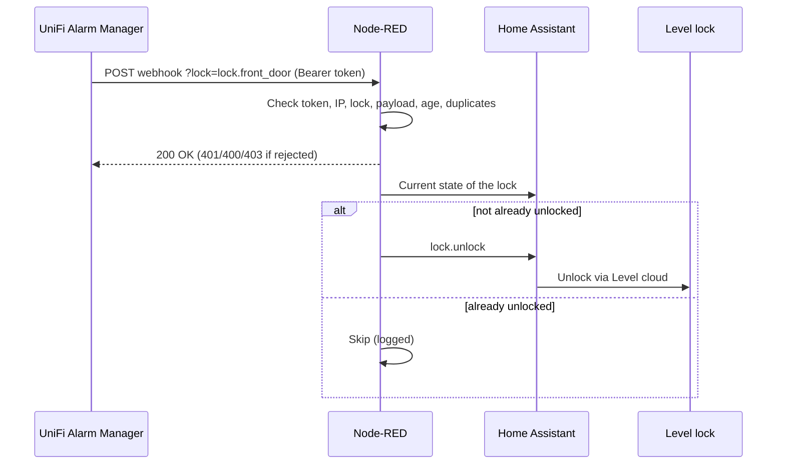

# Node-RED examples

| Flow | What it does |
|---|---|
| [`node-red-flow.json`](node-red-flow.json) | Lock / unlock buttons and a listener for `level_lock_cloud_state_changed` |
| [`alarm-manager-unlock-flow.json`](alarm-manager-unlock-flow.json) | Unlocks a Level lock when UniFi Alarm Manager calls a webhook (e.g. access granted at a reader) |

Import a flow in Node-RED: **Menu → Import → select file → Import**, then pick your Home Assistant server in the Home Assistant nodes.

---

## UniFi Alarm Manager → Level unlock



### What the flow checks

Alarm Manager does not sign its webhooks, so the bearer token is the main protection. The **Check request** node rejects a request unless all of these pass:

| Check | Rejects with |
|---|---|
| Source IP is in `ALARM_MANAGER_ALLOWED_IPS` (only if you set it) | `403` |
| `Authorization: Bearer <token>` matches `ALARM_MANAGER_BEARER` (constant-time compare) | `401` |
| `?lock=` is one of `ALLOWED_LOCKS` | `400` |
| Body is an Alarm Manager payload (has an `alarm` object) | `400` |
| `timestamp` in the body is less than 5 minutes old (skipped if absent) | `400` |
| Not a repeat of an alarm already handled | `200` without unlocking |

### Acknowledging

Yes, the flow must answer: Node-RED keeps the HTTP request open until an **http response** node replies, and Alarm Manager would otherwise wait and time out. The **Acknowledge** node replies right after the checks (`200 ok`, or the error code), *before* the lock is unlocked, so Alarm Manager is never kept waiting on the Level cloud.

### Choosing the lock

Each Alarm Manager webhook picks its lock in the URL:

```
http://<home-assistant-ip>:1880/endpoint/alarm-manager/unlock?lock=lock.front_door
http://<home-assistant-ip>:1880/endpoint/alarm-manager/unlock?lock=lock.garage
```

The value is the Home Assistant entity ID of the Level lock (Settings → Devices & Services → Entities, or the lock's settings dialog). Only locks listed in `ALLOWED_LOCKS` at the top of **Check request** can be unlocked:

```js
const ALLOWED_LOCKS = ["lock.front_door", "lock.garage"];
```

So for two doors: create two alarms in Alarm Manager (one per reader), each with its own webhook URL.

### Setup

1. **Import** [`alarm-manager-unlock-flow.json`](alarm-manager-unlock-flow.json). It creates a tab **Alarm Manager → Level**.
2. **Set the token:** double-click the tab → **Environment**. `ALARM_MANAGER_BEARER` is a *credential* variable: type the token and it is stored encrypted, not exported with the flow. Generate a long random token, e.g. `openssl rand -hex 32`.
   Optionally set `ALARM_MANAGER_ALLOWED_IPS` to your UniFi console's IP (comma-separated for several).
3. **Home Assistant server:** open **Not already unlocked?** and **Unlock** and select your server.
4. **Locks:** edit `ALLOWED_LOCKS` in **Check request** if your entity IDs differ.
5. **Deploy.**
6. **Alarm Manager:** for each reader, create an alarm with the trigger you want (e.g. access granted at that reader) and a **Webhook** action:
   - Method: **POST**
   - URL: the URL above with that door's `?lock=`
   - Header: `Authorization` = `Bearer <your token>`
7. **Port:** with the Home Assistant Node-RED add-on, enable port **1880** in the add-on's Network settings. HTTP In nodes are served under `/endpoint`.

### Test without Alarm Manager

```bash
curl -i -X POST "http://<home-assistant-ip>:1880/endpoint/alarm-manager/unlock?lock=lock.front_door" \
  -H "Authorization: Bearer <your token>" \
  -H "Content-Type: application/json" \
  -d '{"alarm":{"name":"Test"}}'
```

This really unlocks the door if it is locked.

### Troubleshooting

| Node status / response | Cause |
|---|---|
| No response, nothing in Node-RED | Wrong URL or port 1880 not enabled |
| `invalid token` / `401` | Header missing or token differs (Alarm Manager must send `Bearer <token>`) |
| `not configured` / `500` | `ALARM_MANAGER_BEARER` not set on the tab, or not deployed |
| `unknown lock` / `400` | `?lock=` missing or not in `ALLOWED_LOCKS` |
| `source not allowed` / `403` | Request IP not in `ALARM_MANAGER_ALLOWED_IPS` |
| `alarm too old` | Clocks differ by more than 5 minutes: check NTP |
| **Already unlocked (skipped)** debug message | Lock was already unlocked; no command sent |
