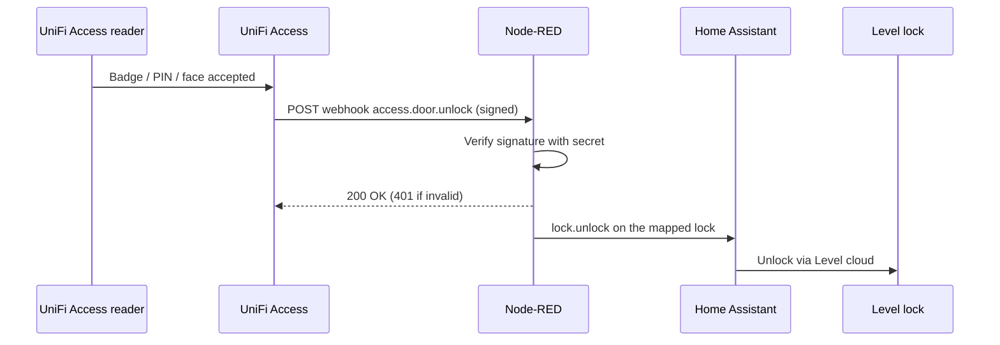

# Node-RED examples

| Flow | What it does |
|---|---|
| [`node-red-flow.json`](node-red-flow.json) | Lock / unlock buttons and a listener for `level_lock_cloud_state_changed` |
| [`unifi-access-unlock-flow.json`](unifi-access-unlock-flow.json) | Unlocks the matching Level lock when a UniFi Access reader grants access |

Import a flow in Node-RED: **Menu → Import → select file → Import**, then pick your Home Assistant server in the Home Assistant nodes.

---

## UniFi Access → Level unlock



### How the flow verifies requests

UniFi Access signs each webhook with a `Signature: t=<unix time>,v1=<hex>` header. `v1` is HMAC-SHA256 of `<t>.<raw body>`, keyed with the webhook secret. The **Verify signature** node:

- recomputes the HMAC over the **raw** body and compares it in constant time;
- rejects signatures older than 5 minutes (replay protection);
- ignores exact repeat deliveries;
- answers `401` for anything invalid, without unlocking.

The secret is read from the Node-RED environment variable `UNIFI_ACCESS_WEBHOOK_SECRET`; it is never stored in the flow.

### Setup

#### 1. Import the flow

Import [`unifi-access-unlock-flow.json`](unifi-access-unlock-flow.json). It creates a tab **UniFi Access → Level**.

- Open **Unlock Level lock** and select your Home Assistant server.
- Open **Map door → lock** and edit `DOORS`, one entry per door:

```js
const DOORS = {
    "Front Door": "lock.front_door",   // UniFi door name (or door ID) → Level lock entity
    "Garage": "lock.garage",
};
```

Use the door names exactly as they appear in UniFi Access. If a name doesn't match, the debug sidebar prints `No Level lock mapped for UniFi door "<name>" (id <id>)`. Copy the name or ID from that line. Using the ID is more robust if you later rename doors.

- Keep **Do not parse body** ticked on **UniFi Access webhook** (HTTP In). The signature can only be checked on the raw body.

#### 2. Create a UniFi Access API token

UniFi Access → **Settings → General → Advanced → API Token** → create a token with permission to manage **webhooks**. (Menu names can vary between Access versions.) Access 2.2.10 or later is required for webhook endpoints.

#### 3. Find the webhook URL

With the Home Assistant **Node-RED add-on**, HTTP In nodes are served under `/endpoint`:

```
http://<home-assistant-ip>:1880/endpoint/unifi-access/unlock
```

Port 1880 must be enabled in the add-on's **Network** settings. Use the IP address of Home Assistant on the same network as the UniFi console.

If the add-on has `http_node` username/password set, add an `Authorization` header when registering the webhook (step 4).

#### 4. Register the webhook in UniFi Access

From a computer on the same network (replace the values in `<>`):

```bash
curl -k -X POST "https://<unifi-console-ip>:12445/api/v1/developer/webhooks/endpoints" \
  -H "Authorization: Bearer <api-token>" \
  -H "Content-Type: application/json" \
  -d '{
        "name": "Node-RED Level unlock",
        "endpoint": "http://<home-assistant-ip>:1880/endpoint/unifi-access/unlock",
        "events": ["access.door.unlock"]
      }'
```

If Node-RED's HTTP endpoints need a password, add `"headers": {"Authorization": "Basic <base64 of user:password>"}` to the JSON.

The response contains a **`secret`**. Keep it for the next step.

#### 5. Set the secret in Node-RED

Node-RED → **Menu → Settings → Environment** → add:

| Name | Value |
|---|---|
| `UNIFI_ACCESS_WEBHOOK_SECRET` | the `secret` from step 4 |

Click **Done**, then **Deploy**. (Global environment variables need Node-RED 3.1 or later.)

#### 6. Test

Badge in at each reader. The nodes show their status:

| Node | Status |
|---|---|
| Verify signature | `access.door.unlock verified`, or the reason it was rejected |
| Map door → lock | `<door> → lock.<entity> (<person>)` |

The **Unlock log** debug node prints the door, person and method for each unlock.

### Troubleshooting

| Symptom | Cause |
|---|---|
| Nothing happens, no node status changes | UniFi can't reach Node-RED: check the URL, port 1880 and any HTTP auth |
| `invalid signature` | Wrong secret, or **Do not parse body** was turned off |
| `signature expired` | Clock difference over 5 minutes between UniFi and Home Assistant: fix NTP |
| `raw body unavailable` | **Do not parse body** is off on the HTTP In node |
| `not configured` | `UNIFI_ACCESS_WEBHOOK_SECRET` is missing; deploy after adding it |
| `unmapped: <door>` | Add that door to `DOORS` |

### Notes

- Only `access.door.unlock` events trigger an unlock. Events whose result says denied/blocked are ignored.
- The unlock goes through the Level cloud and usually takes a few seconds.
- Anyone who can reach the URL can only trigger an unlock with a valid signature, so keep the secret private.
